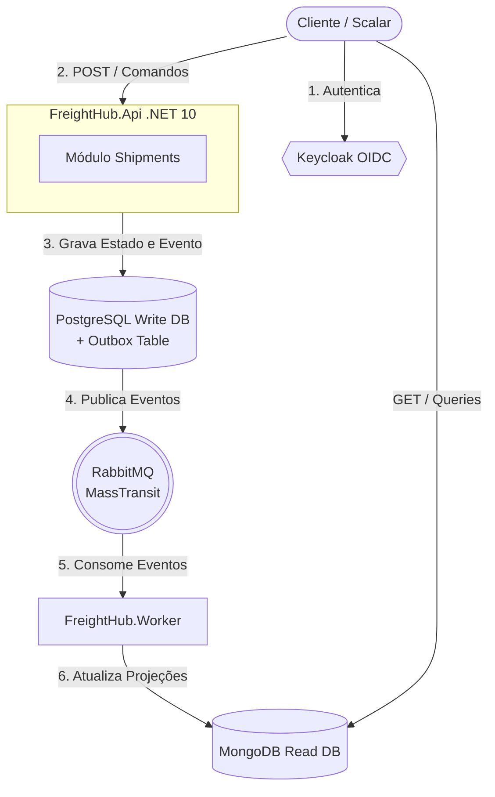

# FreightHub API 🚛

<p align="left">
  
  
  
  
  
  
</p>

Uma API Logtech de nível corporativo construída em **.NET 10** utilizando a arquitetura de **Monólito Modular (Modular Monolith)**. 
Este projeto demonstra padrões avançados de engenharia de software focados em escalabilidade, resiliência e consistência eventual para o ecossistema logístico.

## 🚀 Tecnologias e Padrões (Stack)

*   **Framework:** .NET 10 (C# 13)
*   **Arquitetura:** Clean Architecture, Modular Monolith
*   **Padrões de Design:** CQRS, Event-Driven Architecture, Transactional Outbox, Rich Domain Model, State Machine
*   **Persistência (Escrita):** PostgreSQL 16 + Entity Framework Core 10 (Design Configurations)
*   **Persistência (Leitura):** MongoDB 7.0 (Projeções) *[Em Breve]*
*   **Mensageria:** RabbitMQ + MassTransit *[Em Breve]*
*   **Segurança:** Keycloak (OIDC/OAuth2)
*   **Mediação & Validação:** MediatR, FluentValidation
*   **Infraestrutura & Observabilidade:** Docker Compose, Aspire Dashboard, WireMock, Scalar (OpenAPI)
*   **CI/CD:** GitHub Actions (Pipelines de Build, Test e Linting)

## 🏗️ Desenho Arquitetural (C4 Model - Nível Contêiner)



## ⚙️ Como Executar Localmente

**1. Subir a Infraestrutura (Docker)**
Na raiz do projeto, inicialize os bancos de dados, mensageria e observabilidade:
```bash
docker compose up -d
```

**2. Executar a Aplicação (API)**
```bash
dotnet run --project src/FreightHub.Api
```

A documentação interativa (Scalar/OpenAPI) estará disponível em `http://localhost:5205/scalar/v1`.

---
*Desenvolvido por [Felipe Assis De Souza](https://www.linkedin.com/in/felipeassissouza/) | [GitHub](https://github.com/epilef-azuos)*